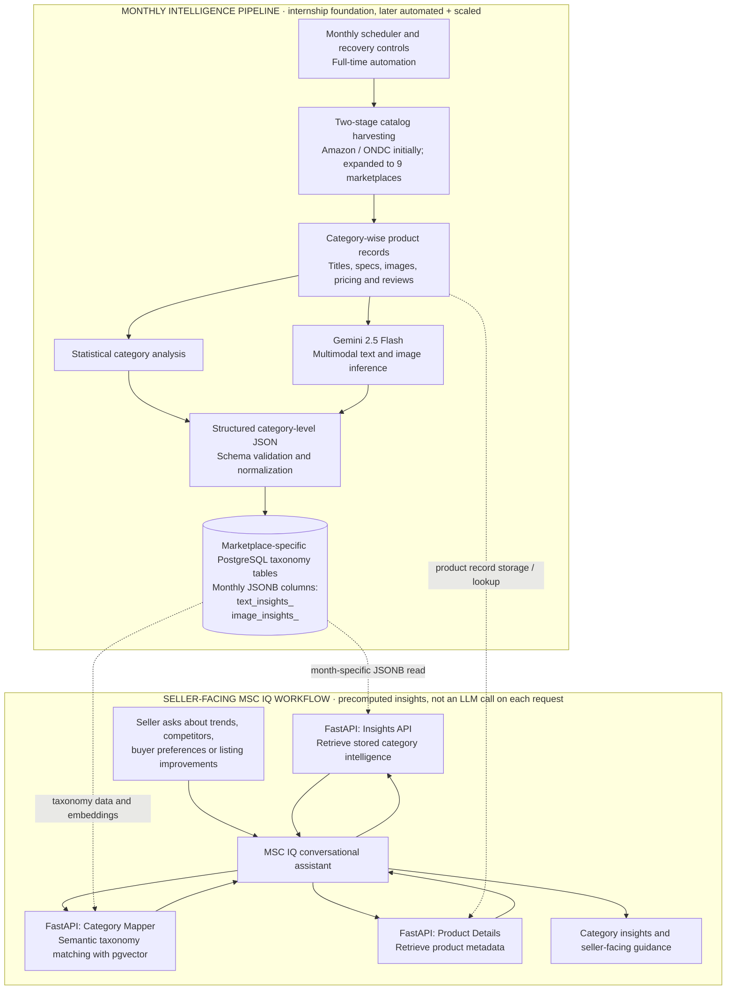
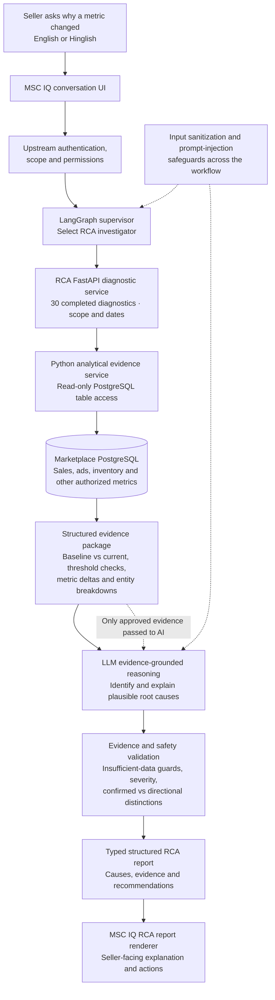

# Unified AI & Cybersecurity Portfolio

> **Production AI Engineer & M.Tech Cyber Security (NIT Patna)**  
> Live Portfolio: [devanshukranjan.github.io/AI-Cybersecurity-Portfolio/](https://devanshukranjan.github.io/AI-Cybersecurity-Portfolio/) *(or custom domain)*  
> Interactive Web Application showcasing applied AI engineering, large-scale data systems, and cybersecurity operations.

[](https://devanshukranjan.github.io/AI-Cybersecurity-Portfolio/)
[](LICENSE)
[](https://linkedin.com/in/devanshu-kumar-ranjan-06399221b)
[](https://github.com/devanshukranjan)

---

## 🎯 The Core Differentiator: The AI & Cyber Overlap

Recruiters and hiring managers typically review candidates who are either pure machine learning practitioners (lacking systems security and networking rigor) or cybersecurity analysts (lacking production LLM/agentic and deep learning experience).

This portfolio represents **the convergence of Applied AI Systems Engineering and Cybersecurity**:
1. **Production AI Systems:** Architect of a completed 30-diagnostic evidence-grounded LangGraph RCA investigator and an integrated multimodal category intelligence platform combining high-throughput catalog ingestion, Gemini-powered insights, PostgreSQL JSONB, pgvector, and FastAPI retrieval.
2. **Privacy-Preserving & Adversarial AI:** M.Tech dissertation on **Locally Differentially Private (LDP)** Federated Sequential Recommendation, proving mathematical and algorithmic rigor in data privacy and secure ML.
3. **Security Operations & Systems Rigor:** Hands-on SOC environment builder (Splunk SIEM, custom SPL, real-time alerting), packet-level network forensics (Wireshark, DoS simulation), and digital forensics (Autopsy, FTK Imager).
4. **Threat Detection ML:** Custom IDS engines built on UNSW-NB15, UGRansome 2024, and Genetic Algorithm (GA) feature selection with XGBoost on Bot-IoT.

---

## 🏗️ Repository Architecture

```text
AI-Cybersecurity-Portfolio/
├── index.html                   # Semantic Single-Page Application (SPA)
├── projects.html                # Complete Systems Matrix & Two-Tier Filter Grid
├── style.css                    # Cyber-Tech Command Center Design System (Vanilla CSS)
├── script.js                    # Dynamic Spectrum Controller & Case Study System
├── work-experience/             # Master Career Records & Technical Dossiers
│   └── kas-global-commerce-master-record.md
├── favicon.svg                  # Custom Vector Tech Icon
├── assets/
│   ├── resumes/                 # Official ATS Resumes (AI & Cyber Tracks)
│   │   ├── Devanshu_AI_Resume.pdf
│   │   ├── Devanshu_Cybersecurity_Resume.pdf
│   │   └── Devanshu_AI_Security_Resume.pdf
│   └── screenshots/             # Existing UI examples and lab screenshots
├── docs/                        # Editable Mermaid diagrams and resume LaTeX sources
├── tests/                       # Portfolio integrity and browser interaction checks
└── README.md                    # Project Documentation
```

---

## ⚡ Featured Projects & Systems

### 1. The Intersection (Core Edge)
* **Privacy-Preserving Federated Sequential Recommendation (M.Tech Dissertation):** Formulated **LDP-SeqMask** and a calibrated Laplace perturbation mechanism with **View-based Contrastive Learning (View-CL)** to prevent trajectory leakage in sequential recommendation.
* **Autonomous AI-Based Threat Detection & Threat Elimination Engine (Hermes):** Dual-tier intrusion detection and autonomous quarantine engine trained on **200,043 network records** (UGRansome2024 + UNSW-NB15). Fuses **Tab2Image 2D CNN spatial matrices** (96.9% acc) with an unsupervised **Deep Autoencoder zero-day override** (MSE threshold 0.05) and a live **Tkinter SOC console** with automated firewall quarantine.
* **GA-Optimized Bot-IoT IDS:** Genetic Algorithm feature selection reducing Bot-IoT network features from 43 to 22 (48.8%) before XGBoost multiclass evaluation; see the linked project for the detailed method.

### 2. Applied AI & Production Systems (KAS Global Commerce / MSC IQ)

The two **major systems** are distinct products with clear seller-facing value:

1. **[Completed Evidence-Grounded LangGraph RCA Investigator](index.html#proj-rca-engine)** — **30 completed diagnostics** across marketing/advertising, orders, business and inventory. A Python analytical service computes and retrieves authorized diagnostic metrics using read-only access to PostgreSQL tables; AI investigates the evidence to infer root causes and returns ranked, actionable explanations to marketplace sellers. Evidence-fetch latency improved from **over 60 seconds to under 7 seconds (88%+)** through parallel queries, indexing and join optimization; this is *not* the complete AI response time.
2. **[Multimodal Marketplace Category Intelligence Platform](index.html#proj-marketplace-category-intelligence)** — one connected system comprising the **two-stage catalog scraper**, **taxonomy vector matching**, **Gemini 2.5 Flash text and image insight generation**, **marketplace-specific monthly JSONB storage**, and **three FastAPI services**. It helps sellers understand category trends, competitor products, buyer preferences and opportunities to improve listings. Built during the AI Research Internship (Sep 2025–Jun 2026), then automated and expanded to **nine marketplaces** during the AI Engineer role (Jul 2026–present).

The **Amazon A+ competitive content intelligence** work is a separate production contribution and is not part of the four-component catalog platform merger.

#### Integrated platform — two connected flows



The stored month-specific JSONB columns follow the literal convention `text_insights_<mm-yyyy>` and `image_insights_<mm-yyyy>` inside marketplace-specific PostgreSQL taxonomy tables. These are **date-suffixed columns**, not separate tables or physical PostgreSQL partitions. The `/api/v1/insights` endpoint retrieves previously generated insights; Gemini inference runs during monthly preparation, not on each Insights API request.

#### Evidence-grounded RCA architecture



The RCA playbook and architecture notes dated September/October 2026 describe historical development stages. The project owner confirms that the final implementation contains **30 completed diagnostics**, using Python evidence retrieval with read-only PostgreSQL table access followed by AI-based root-cause analysis. Public case studies present a conceptual architecture, not sensitive production topology or source code.

### 3. Cybersecurity Operations & Forensics Labs
* **Splunk SIEM Enterprise SOC Lab:** 3-VM virtual SOC environment with Kali Linux attacker (Hydra brute-force, Nikto scans) and Ubuntu target forwarding logs to Splunk Enterprise via Universal Forwarder.
* **DoS Attack Simulation & Packet Forensics:** 6 attack flood vectors on Metasploitable 2 with Wireshark PCAP deep-dive protocol analysis.
* **Digital Forensic Investigation & File Recovery:** FTK Imager evidence acquisition (.dd), hash verification (MD5/SHA1), Autopsy timeline analysis, and hex signature file carving.

---

## Navigation compatibility and architecture sources

The portfolio has **11 unique projects**, **6 featured**. Discipline filters include 7 AI/overlap, 8 security/overlap and 4 overlap projects. The marketplace platform has one card per page and one canonical case-study entry. Its legacy anchors (`#proj-scraper-engine`, `#proj-vector-taxonomy`, `#proj-text-image-insights`, `#proj-common-api`) point inside the combined card. Legacy JavaScript keys (`scraping-engine`, `category-mapper`, `text-image-insights`, `chatbot-rag`) open the canonical modal, including when used as URL fragments.

These updates use GitHub `main` commit `ba795d9` as their base. The homepage preserves the sticky split showcase and displays **four highlights**, with **RCA first** and the marketplace platform **second**. The archive retains its sticky search/filter explorer, typo-tolerant search, and light/dark themes; case studies retain the redesigned metric HUD, pipeline, evidence gallery, and dossier. The primary resume PDFs retain GitHub's two-page format, with the experience content updated in place; the supplied LaTeX files remain optional compact resume variants.

Both diagrams are editable: [marketplace data flow](docs/Marketplace_Category_Intelligence_Architecture.mmd) and [evidence-grounded RCA](docs/Evidence_Grounded_RCA_Architecture.mmd). The HTML/CSS case-study diagrams work without a Mermaid runtime. See the [master experience record](work-experience/kas-global-commerce-master-record.md) for chronology, boundaries and role-specific summaries, and [update notes](Portfolio_Update_Notes.md) for validation and remaining verification questions.

## 🚀 Running Locally

This portfolio is built purely with **Vanilla HTML, CSS, and JavaScript** with zero build tools or npm dependencies required:

1. **Clone the repository:**
   ```bash
   git clone https://github.com/devanshukranjan/AI-Cybersecurity-Portfolio.git
   cd AI-Cybersecurity-Portfolio
   ```

2. **Open in any modern browser:**
   - Double-click `index.html`, or
   - Start a local server:
     ```bash
     python -m http.server 8000
     # Then visit http://localhost:8000 in your browser
     ```

### Validation

Run the dependency-free integrity checks with Node.js:

```bash
node --check script.js
node --test tests/portfolio.test.mjs
```

The optional browser checks use a dedicated Chrome debugging session and the local server above. Launch Chrome with `--headless=new --remote-debugging-port=9223 --user-data-dir=<temporary-profile-directory>`, then run `node tests/browser-check.mjs`. `BASE_URL` and `CDP_URL` can override the default local addresses. The checks block external font/icon CDNs and exercise the local pages at desktop, tablet and mobile widths. Stop the temporary browser and server afterward.

---

## 📄 License & Attribution

This project is open-source under the [MIT License](LICENSE).  
Copyright &copy; 2026 Devanshu Kumar Ranjan. All rights reserved.
