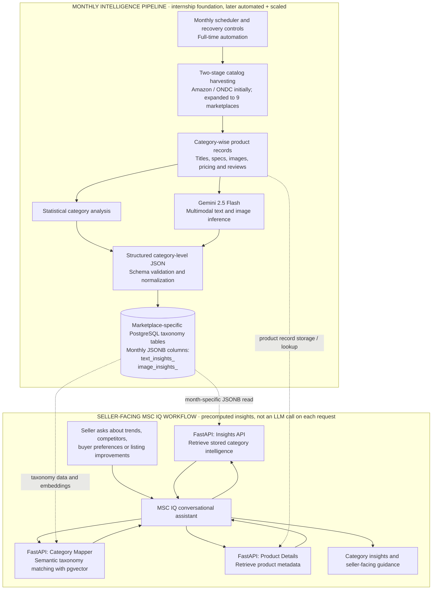
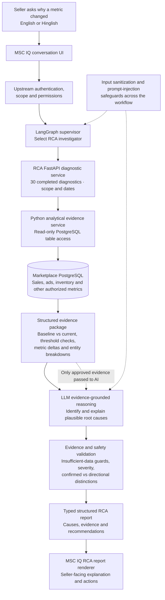

# KAS Global Commerce — Master Engineering Experience Record

> **Record status:** Updated November 2026 using the project owner's current clarifications. Earlier RCA documents are historical snapshots.
> **Employer:** KAS Global Commerce Inc. — MySellerCentral / MSC IQ
> **Role progression:** AI Research Intern (**Sep 2025–Jun 2026**) → AI Engineer (**Jul 2026–present**)
> **Work location:** Bilaspur, Himachal Pradesh, India (on-site)
> **Publication guidance:** Keep private code, customer information, service credentials, internal network topologies and undisclosed weaknesses out of the public portfolio.

## 1. Executive summary

Two flagship, separate business-facing production systems summarize this work:

1. **Multimodal Marketplace Category Intelligence Platform:** an integrated catalog-to-insights system for helping sellers understand category trends, competitor products, buyer preferences and listing improvements. Its foundation was built during the internship and its recurring monthly process was subsequently automated and expanded to nine marketplaces during full-time employment.
2. **Completed 30-diagnostic LangGraph RCA Investigator:** a natural-language root-cause analysis workflow where Python services retrieve and calculate analytical evidence using read-only access to PostgreSQL tables, and AI evaluates the evidence to identify plausible causes and seller actions. The final diagnostic suite is complete, across marketing, orders, business and inventory topics.

Also separately developed competitive Amazon A+ visual intelligence and mentored engineering teammates. Do **not** merge the A+ project into the category intelligence platform or RCA product.

## 2. End-user value and ownership boundaries

**Category intelligence:** Sellers use MSC IQ to explore category demand/trends, competitor patterns, likely customer preferences and listing opportunities. The Category Mapper provides semantic taxonomy matching, the Insights API retrieves *precomputed monthly JSONB intelligence*, and Product Details supplies record-level context. The underlying batch process runs separately from interactive seller queries.

**RCA investigator:** Sellers ask questions such as "Why did ACOS rise?", "Why did ROAS fall?", or "Why are sales down?". MSC IQ routes to the RCA engine, which combines account-scoped evidence gathering with read-only PostgreSQL table access, AI interpretation of evidence, and typed reports containing ranked causes, severity and recommendations.

## 3. ONE integrated Multimodal Marketplace Category Intelligence Platform

**Public portfolio canonical anchor:** `#proj-marketplace-category-intelligence`
**Historic anchors (redirect to the same project):** `#proj-scraper-engine`, `#proj-vector-taxonomy`, `#proj-text-image-insights`, `#proj-common-api`.

### 3.1 Offline monthly preparation / online query serving

**Offline work:** The two-stage Zyte scraper gathers category-wise product records (metadata, titles, attributes, images, reviews and pricing as available), initially for Amazon and ONDC. Statistical analysis and Gemini 2.5 Flash multimodal text/image inference transform product records into category-level structured JSON insights. PostgreSQL stores those precomputed outputs in marketplace-specific taxonomy tables. Scheduled monthly orchestration and downstream processing automation were added after promotion.

**Online work:** MSC IQ handles seller-facing conversation. The category mapper (`/api/v1/category-mapper`) uses normalized taxonomy embeddings and PostgreSQL `pgvector` to disambiguate categories. The Insights API (`/api/v1/insights`) retrieves previously generated category insights from PostgreSQL JSONB; Product Details (`/api/v1/product-details`) provides listing context. The three APIs are **not** three independent business products and do not imply that Gemini is re-run per API request.

### 3.2 PostgreSQL storage contract

- Marketplace-specific taxonomy tables contain category identifiers, normalized breadcrumbs and embeddings needed for mapping.
- Monthly text and image insight outputs are JSONB stored in columns named **`text_insights_<mm-yyyy>`** and **`image_insights_<mm-yyyy>`**.
- Example monthly suffix: `text_insights_11-2026` / `image_insights_11-2026`.
- These are **columns**, not physical PostgreSQL partitions or separate month-tables. Do not claim partitioning solely from the naming scheme.
- `/api/v1/insights` retrieves precomputed category JSON; selection of current/historic month is part of the logical storage access. Do not claim a specific month-fallback algorithm without inspecting code.

### 3.3 Internship: build the foundation (Sep 2025–Jun 2026)

- Designed and implemented the **two-stage distributed catalog scraper**, with Zyte API concurrency at up to **1,000 requests/min** and MongoDB persistence. Reduced complete catalog harvesting from **2–3 months to around 1.5 weeks**, a substantial reduction versus legacy operations.
- Developed taxonomy breadcrumb normalization and dense semantic category mapping using OpenAI `text-embedding-3-large` (3,072-dimensional vectors), PostgreSQL `pgvector` and IVFFLAT nearest-neighbor indexing; observed **sub-50 ms vector lookups**.
- Built **Gemini 2.5 Flash multimodal category insight generation** from scraped product text and images, combined with category-level statistical analysis, structured output processing and monthly PostgreSQL JSONB storage.
- Implemented **three FastAPI microservices**: category mapper, insights retrieval and product details for MSC IQ seller interaction.
- **Scope boundary:** Initial Amazon/ONDC foundation and monthly insight dataset development. Do not attribute the later full zero-touch monthly orchestration or all nine marketplaces to the internship.

### 3.4 Full-time: automate and scale (Jul 2026–present)

- Orchestrated recurring monthly catalog harvesting with **cron**, then triggered downstream Gemini multimodal insights processing after extraction completion, with error recovery/schema-handling enhancements.
- Expanded the same integrated scraping, normalization, insight generation and storage workflow to **nine global marketplaces** through modular marketplace adapters; do not invent undocumented marketplace names.
- Reduced routine manual work for the recurring monthly catalog-to-insights cycle to **zero intervention** under normal operation, while retaining the FastAPI retrieval path for MSC IQ.

### 3.5 Resume-ready category-platform bullets

**Internship (GenAI):** Built a Gemini 2.5 Flash text/image category intelligence pipeline from Zyte-scraped Amazon/ONDC product catalogs; persisted monthly JSONB insights in marketplace-specific PostgreSQL taxonomy tables and exposed precomputed outputs through FastAPI to support sellers' competitive and listing decisions.

**Full-time (platform scaling):** Automated monthly catalog scraping → Gemini multimodal insight generation → JSONB persistence with cron-based recovery, scaling the integrated category intelligence platform to nine marketplaces without routine manual intervention.

**Python Backend:** Built the data ingestion, semantic matching and three FastAPI retrieval services connecting batch LLM insights to MSC IQ's online seller experience.

## 4. Completed 30-diagnostic LangGraph RCA Investigator (full-time)

### 4.1 User-facing problem and outcome

A seller can ask why a marketplace metric deteriorated (e.g., ACOS, ROAS, CPC, CTR, conversion, sales). The completed **30-diagnostic** system covers the finalized marketing, orders, business and inventory diagnostic scope and returns evidence-based, prioritized causes with severity and suggested actions.

### 4.2 CURRENT evidence-grounded AI architecture

The full-time system evolved beyond the historical rule-centric stage:

1. MSC IQ authenticates and scopes the seller's request and LangGraph supervisor routes the question to RCA.
2. The RCA service resolves the diagnostic, comparison time windows, marketplace and authorized data scope.
3. A **Python analytics service** accesses authorized PostgreSQL tables in read-only mode through bounded queries and computes or collects evidence: baseline/current deltas, statistical thresholds and relevant campaign, ASIN, inventory, order or keyword-level records.
4. **AI reasons over the structured evidence** to determine and explain root causes and propose recommendations; numerical inputs are grounded in the Python evidence, not fabricated by the model.
5. Evidence sufficiency, comparison windows, input sanitization, prompt-injection guards and typed schema checks constrain invalid or unsupported results.
6. MSC IQ renders structured report sections, prioritized causes, severity and recommendations in the seller dashboard.

**Important:** The September RCA playbook and October system architecture document describe **earlier snapshots**: 23 diagnostics scoped and a smaller loaded registry, plus deterministic evidence-to-formatter logic. The user confirms **the final system is complete with 30 diagnostics and a newer AI reasoning stage**. Do not repeat outdated live/planned counts as current or claim the old documents describe the final code path. The updated inventory of all 30 *names* has not been furnished; do not invent the missing names.

### 4.3 Query optimization (evidence retrieval, not end-to-end LLM latency)

| Metric | Before | After | Method |
|---|---:|---:|---|
| PostgreSQL analytics/evidence fetch | >60 seconds | <7 seconds (88%+ reduction) | Independent query parallelization, B-tree/GIN indexing and optimized joins |

This stage metric **must not** be mislabeled as total RCA response time. The former documentation also describes historical longer end-to-end requests; they measured a different scope and earlier system state.

### 4.4 Security and evidence safeguards

- Input validation and prompt-injection safeguards around seller questions and LLM interpretation.
- Account- and marketplace-scoped evidence fetching with read-only access to PostgreSQL tables; the AI analysis stage receives prepared evidence rather than arbitrary database access.
- Data sufficiency guards, proper current/baseline comparison windows and appropriate severity/confidence communication.
- Typed report outputs and safe formatting for the UI; do not publicly disclose private service topology or unapproved details.

### 4.5 Resume-ready RCA bullets

**GenAI / Agentic AI:** Architected a production LangGraph RCA investigator spanning 30 completed diagnostics; integrated Python evidence retrieval through read-only PostgreSQL table access with LLM-based root-cause reasoning and evidence-backed structured seller explanations.

**AI Security:** Built a bounded Python analytics layer with read-only access to PostgreSQL tables and prompt-injection/input safeguards for evidence-grounded agentic inference, limiting the model to scoped business evidence and validated outputs.

**Python Backend:** Reduced PostgreSQL RCA evidence-fetch latency by 88%+ (>60s to <7s) through parallel independent queries, compound indexes and query optimization.

## 5. Other distinct engineering contributions

### Amazon A+ Multimodal Competitive Intelligence

- Built structured analysis of competitor Amazon A+ visuals (layout, background, product positioning, headline messaging and visual patterns) using Gemini 2.5 Flash Vision.
- Production analysis was implemented for Module 5 (Standard Image & Dark Text Overlay) across category best-sellers. Other modules were described as roadmap coverage in the original dossier; do not claim their completion without later confirmation.

### Engineering mentorship and operational governance

- Guided junior engineering teammates on marketplace adapter normalization, retries/backoffs, and monitoring of recurring ingestion and multimodal analytics workflows.

## 6. Verified impact summary

| Outcome | Source phase | Statement safe for resume / public portfolio |
|---|---|---|
| Catalog harvesting | Internship | Legacy 2–3 months → about 1.5 weeks, up to 1,000 Zyte requests/min |
| Taxonomy matching | Internship | PostgreSQL/pgvector semantic category lookup in sub-50 ms |
| Multimodal category intelligence | Internship | Gemini 2.5 Flash + statistics → marketplace-specific month-suffixed JSONB insights → FastAPI Insights API |
| Recurring monthly automation | Full-time | Scheduled scraping and downstream insight generation without routine manual intervention |
| Marketplace expansion | Full-time | Same integrated platform extended to nine marketplaces |
| RCA delivery | Full-time | 30 completed diagnostics, owner-confirmed November 2026 |
| RCA query optimization | Full-time | Evidence retrieval >60 seconds → <7 seconds, 88%+ reduction |

## 7. Interview-ready STAR narratives

**Integrated marketplace category intelligence:** Situation — sellers needed repeated, cross-marketplace category and competitor analysis rather than one-off catalog dumps. Task — make category product information usable through MSC IQ. Action — built two-stage harvesting, multimodal JSON generation and pgvector/JSONB/API retrieval during internship, then automated scheduled upstream/downstream processing and expanded adapters across marketplaces in full-time work. Result — extraction time reduced to 1.5 weeks, sub-50 ms semantic lookups, nine marketplaces and monthly zero-routine-intervention operation.

**Evidence-grounded RCA upgrade:** Situation — sellers needed credible reasons behind changing ad, revenue and operational metrics, but expensive analytical fetches and rules alone limited the investigation workflow. Task — deliver an evidence-backed AI investigator. Action — architected LangGraph-to-RCA orchestration, implemented Python evidence gathering through read-only access to PostgreSQL tables, optimized analytical queries, passed structured evidence to AI reasoning, and validated structured reports. Result — 30 completed diagnostics and 88%+ lower evidence-fetch latency, with actionable seller reports.

## 8. Final accuracy checks before publishing

- Confirm the currently public 30-diagnostic implementation with the latest engineering inventory; **30 is owner-confirmed**, but the complete named registry is not attached.
- The portfolio's Bot-IoT project describes 43 → 22 features (48.8%). Older over-70% statements elsewhere are inconsistent and should be corrected to match the exact run.
- M.Tech Cyber Security CGPA: 9.06/10 across current resumes; a legacy JavaScript metadata label of 8.84/10 should be corrected.
- Check public availability/permission for screenshots and nonpublic internals before publishing to GitHub.

## 9. Engineering tradeoffs and verification boundaries

**Precomputation and freshness:** Monthly multimodal inference is separated from interactive retrieval. Sellers receive the last completed batch rather than a live model analysis of the marketplace. Batch completion and data freshness need operational monitoring.

**Storage:** Month-suffixed JSONB columns keep category insights attached to marketplace taxonomy records and allow monthly outputs to coexist. Adding months requires schema handling; the column naming convention is not evidence of physical database partitioning. No undocumented month-fallback algorithm is claimed.

**Batch reliability:** Completion-triggered downstream processing, recovery and marketplace normalization support the recurring workflow. Zero routine monthly intervention describes normal operation, not an absence of exceptional failures or adapter maintenance.

**Evidence versus inference:** A diagnostic scopes an investigation. Metric checks establish observations; AI reasons over those observations to infer causes. Reports distinguish directly supported findings from directional interpretations. Numeric/data-sufficiency guards and typed outputs reduce unsupported conclusions without guaranteeing every explanation.

**Outstanding verification:** The full named list of all 30 diagnostics, continued applicability of the historical 50+ root-cause-rule count, end-to-end AI report latency, and final reasoning accuracy are not supplied. The 30-completed status is owner-confirmed. No additional diagnostic names, accuracy figures, model identity or confidence algorithm are inferred.

## 10. Role-specific resume summaries

**AI / GenAI:** Production AI Engineer building evidence-grounded LangGraph diagnostics and multimodal seller intelligence. Delivered 30 completed RCA diagnostics and an internship-built category platform later automated across nine marketplaces; combines Python analytics, Gemini batch inference, pgvector and FastAPI.

**AI Security:** AI Engineer and M.Tech Cyber Security graduate applying scoped evidence retrieval through read-only PostgreSQL table access, input/prompt-injection safeguards and validated structured outputs to agentic diagnostics, alongside practical intrusion-detection and SOC laboratory work.

**Python Backend:** Python Engineer connecting high-throughput harvesting, PostgreSQL/JSONB, semantic retrieval and three FastAPI services to MSC IQ. Reduced RCA evidence-fetch latency from >60 seconds to <7 seconds and automated recurring cross-marketplace data processing.
